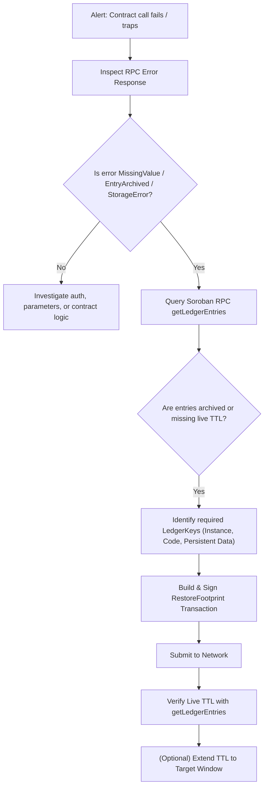

# Emergency State Restoration Runbook (Soroban Archive Restoration)

This runbook documents the end-to-end operational procedure for diagnosing, preparing, simulating, and restoring archived Soroban contract state entries, contract instances, and contract WASM bytecode across the Latch contract ecosystem.

It satisfies the operational recovery requirements identified in [THREAT_MODEL.md](THREAT_MODEL.md) (DoS.2 / TM-D) and addresses state TTL expiration scenarios described in [almanax-triage.md](almanax-triage.md) and [`templates/timelock-vault`](../templates/timelock-vault/src/lib.rs).

---

## 1. Overview & Architecture

### 1.1 Soroban State Expiration & Archival Lifecycle
Soroban manages ledger bloat using State Expiration and Time-To-Live (TTL) counters measured in ledgers (~5 seconds per ledger on Stellar networks):

1. **Active State:** The entry's TTL is above current ledger height. Invocations read and write normally.
2. **Expired / Archived State:** When an entry's TTL is exceeded without renewal:
   - **Temporary Storage:** Expired entries are permanently destroyed and cannot be restored.
   - **Persistent Storage:** Data entries are evicted from active memory into the **archive**.
   - **Contract Instance (`ContractData` with key `ContractExecutable` / instance):** Evicted into the archive. Calls to the contract immediately fail/trap.
   - **Contract Executable (`ContractCode` / WASM bytecode):** If unreferenced or expired, evicted into the archive.
3. **Restored State:** Archived persistent entries, contract instances, and contract bytecode are brought back into active ledger storage via a `RestoreFootprint` transaction operation.

> [!IMPORTANT]
> Contract calls do **not** automatically restore archived entries. Invoking a contract whose instance, WASM code, or referenced persistent data keys are archived will cause the transaction to fail or trap with host error code `HostStorageError::UnknownError` / `Error(Storage, MissingValue)`. The entry must be restored via `RestoreFootprint` **prior to** or **within** the operational transaction pipeline.

### 1.2 Storage Types in Latch Contracts

| Storage Type | Used For in Latch | Archive Behavior | Recovery Method |
|---|---|---|---|
| **Contract Instance** | Contract instance metadata, executable link, and instance storage (`DeployedContractCount`, etc.) | Archived when instance TTL drops below ledger sequence | `RestoreFootprint` with `LedgerKey::ContractData` (instance key) |
| **Contract Code** | Compiled WASM bytecode referenced by contract instances | Archived when code TTL expires | `RestoreFootprint` with `LedgerKey::ContractCode` |
| **Persistent Storage** | Timelock owner/unlock ledger, vesting schedule records, smart account satellite records (`DeployedContract(index)`), policy rule configs, spending history | Archived when persistent entry TTL expires | `RestoreFootprint` with `LedgerKey::ContractData` (persistent key) |
| **Temporary Storage** | Nonce tracking, temporary auth tokens (if any) | **Permanently deleted** upon expiration | Cannot be restored; must be re-created |

---

## 2. Emergency Assessment & Diagnostic Workflow

When a user or relayer reports that transactions fail against an established contract, follow this triage workflow:



### 2.1 Diagnosing via Stellar CLI
Ensure you have the Stellar CLI installed (`stellar` or `soroban-cli` v21+). Configure your target network (e.g., `testnet` or `mainnet`):

```bash
# Set network environment variables
export STELLAR_RPC_URL="https://soroban-testnet.stellar.org"
export STELLAR_NETWORK_PASSPHRASE="Test SDF Network ; September 2015"
export CONTRACT_ID="C..." # Address of the affected contract
```

Inspect the contract instance and state:

```bash
# Inspect contract instance and live storage
stellar contract inspect --id $CONTRACT_ID --network testnet
```

### 2.2 Diagnosing via Soroban RPC `getLedgerEntries`
Submit a JSON-RPC request to `getLedgerEntries` requesting the contract's instance key and data keys.

Archived entries will return a response where:
- Either the entry is returned with `liveUntilLedgerSeq` in the past or omitted from active state, OR
- The RPC indicates the entry is archived in secondary storage, requiring restoration.

---

## 3. Footprint Construction & Ledger Keys

To restore state, every archived ledger entry key must be included in the transaction footprint's `readWrite` list for a `RestoreFootprint` operation.

### 3.1 LedgerKey Types

1. **Contract Instance Key (`ContractData`):**
   - `contract`: Contract address (`Address::Contract(contract_id)`)
   - `key`: `ScVal::LedgerKeyContractInstance`
   - `durability`: `Persistent` (instance storage shares the instance durability)

2. **Contract Code Key (`ContractCode`):**
   - `hash`: SHA-256 hash of the contract WASM bytecode

3. **Persistent Data Key (`ContractData`):**
   - `contract`: Contract address
   - `key`: The specific `ScVal` key (e.g., `Symbol("Owner")`, `Symbol("UnlockLedger")`, `LatchSmartAccountStorageKey::DeployedContract(u32)`)
   - `durability`: `Persistent`

### 3.2 Key Footprint Requirements for Latch Contracts

#### Timelock Vault (`templates/timelock-vault`)
- Contract instance: `LedgerKey::ContractData` (Instance)
- Contract code: `LedgerKey::ContractCode` (WASM hash)
- Persistent entry: `Symbol("Owner")`
- Persistent entry: `Symbol("UnlockLedger")`

#### Vesting Schedule (`templates/vesting-schedule`)
- Contract instance: `LedgerKey::ContractData` (Instance)
- Contract code: `LedgerKey::ContractCode` (WASM hash)
- Persistent entry: `Symbol("Schedule")`

#### Latch Smart Account (`latch-smart-account`)
- Contract instance: `LedgerKey::ContractData` (Instance, includes `DeployedContractCount`)
- Contract code: `LedgerKey::ContractCode` (WASM hash)
- Persistent entries: `LatchSmartAccountStorageKey::DeployedContract(index)` for all registered satellite contracts (`index` from 0 to `DeployedContractCount - 1`)

---

## 4. Step-by-Step Restoration Procedure

### Step 1: Automated Restoration via Stellar CLI (Recommended)

The Stellar CLI provides a high-level command to restore contracts and their storage entries automatically.

```bash
# 1. Restore the contract instance and code
stellar contract restore \
  --id $CONTRACT_ID \
  --source-account <ADMIN_OR_OPERATOR_SECRET_OR_KEY_NAME> \
  --network testnet

# 2. If specific persistent keys are archived, restore via explicit ledger key or footprint:
stellar contract restore \
  --id $CONTRACT_ID \
  --key-xdr <BASE64_ENCODED_SCVAL_KEY> \
  --durability persistent \
  --source-account <OPERATOR_KEY_NAME> \
  --network testnet
```

### Step 2: Manual Footprint Restoration via Stellar CLI / Transaction Engine

When granular control over the restoration footprint is required (such as restoring multiple keys in one atomic transaction):

1. **Generate the Transaction Envelope:**
   Create a transaction containing a single operation: `Operation::RestoreFootprint`.

2. **Specify the Footprint (`SorobanTransactionData`):**
   - `resources.footprint.readWrite`: List of all `LedgerKey`s to be restored.
   - `resources.footprint.readOnly`: Empty (`[]`).
   - `resourceFee`: Calculated rent fee required to restore entries back into ledger memory for the minimum live TTL window (e.g., at least 4,096 ledgers).

3. **Simulate the Restoration:**
   Send the unsigned transaction to the `simulateTransaction` RPC endpoint.
   - The simulation computes the exact restoration fee, gas units, and validates the footprint keys.
   - Simulation output returns the updated `SorobanTransactionData` containing rent fees.

4. **Sign the Transaction:**
   Sign the transaction using an operator account that funds the restoration rent:
   ```bash
   stellar tx sign --network testnet --source-account <OPERATOR_SECRET> unsigned_tx.json
   ```

5. **Submit to Network:**
   ```bash
   stellar tx send --network testnet signed_tx.json
   ```

---

## 5. Post-Restoration TTL Extension (Bump TTL)

A newly restored entry is only restored to the minimum live TTL permitted by network parameters (typically 1–16 ledgers unless additional rent is paid). **Immediately following restoration, the operator or owner must extend the TTL** to prevent immediate re-archival.

### 5.1 Using Contract Keep-Alive Functions
For contracts equipped with in-contract `bump_ttl` functions:

- **Timelock Vault:**
  The `bump_ttl()` function is permissionless and extends both `Owner` and `UnlockLedger` persistent entries:
  ```bash
  stellar contract invoke \
    --id $TIMELOCK_VAULT_CONTRACT_ID \
    --source-account <ANY_CALLER> \
    --network testnet \
    -- bump_ttl
  ```

- **Deposit Action:**
  For timelock vaults, invoking `deposit` also automatically calls `extend_ttl` for all persistent entries.

### 5.2 Using Stellar CLI `extend`
For contracts without dedicated bump functions (or to extend contract code and instance TTL directly):

```bash
# Extend contract instance and code TTL
stellar contract extend \
  --id $CONTRACT_ID \
  --ledgers-to-extend 500000 \
  --source-account <OPERATOR_KEY_NAME> \
  --network testnet

# Extend a persistent data entry TTL
stellar contract extend \
  --id $CONTRACT_ID \
  --key-xdr <BASE64_ENCODED_SCVAL_KEY> \
  --durability persistent \
  --ledgers-to-extend 500000 \
  --source-account <OPERATOR_KEY_NAME> \
  --network testnet
```

---

## 6. Edge Cases, Failure Modes & Remediation

| Failure Mode / Error | Root Cause | Remediation Procedure |
|---|---|---|
| `txBAD_SEQ` / Simulation Error: `MissingValue` during `withdraw()` or contract invocation | Contract instance or persistent storage key is archived | Run `stellar contract restore` for both the contract ID and all required persistent storage keys before re-attempting withdrawal. |
| `RestoreFootprint` fails with `txINTERNAL_ERROR` or invalid footprint | One or more keys in `readWrite` do not exist or are already active | Run `simulateTransaction` against Soroban RPC to generate the precise footprint. Do not include already active keys in `RestoreFootprint`. |
| Contract code (`ContractCode`) missing after restoring instance | Code WASM entry expired separately from the instance | Include the `LedgerKey::ContractCode(wasm_hash)` in the restoration footprint. Retrieve the `wasm_hash` from deployment records in `deployments/README.md` or from inspecting the contract. |
| Restored contract immediately re-archives | TTL was not extended after restoration | Run `stellar contract extend` or call `bump_ttl()` within the initial restore grace window. |
| Permissionless caller denied on restore | Misconception: `RestoreFootprint` requires contract owner auth | `RestoreFootprint` is a network-level operation. **Any account** can pay the transaction rent to restore any public contract entry or code. |

---

## 7. Operational Checklist & Verification

Before closing an emergency restoration incident:

- [ ] All required ledger keys (Code, Instance, Persistent entries) have status `Active` in RPC `getLedgerEntries`.
- [ ] Contract instance and persistent entry TTLs have been extended past the expected lock or operational window (at least 500,000 ledgers / ~30 days).
- [ ] Test transaction simulation passes without `Storage` or `MissingValue` errors.
- [ ] Downstream indexers and monitoring systems reflect restored status.
- [ ] Post-incident review logged in security operations incident tracker.
